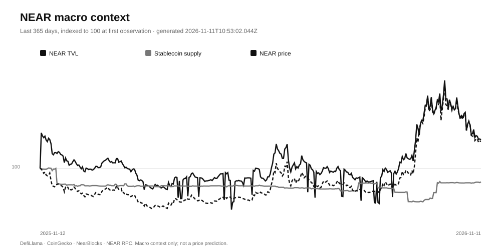

# NARRAX — NEAR macro context

Generated: 2026-11-14T03:36:11.152Z

This is a keyless public-data snapshot. It is the slow macro clock, not a price prediction and not the token-level conversion evidence in [`THESIS_EVIDENCE.md`](./THESIS_EVIDENCE.md).

## Snapshot

| Metric | Latest | 30d change | 90d change | 365d change |
| --- | ---: | ---: | ---: | ---: |
| NEAR TVL | $158,696,475 | -29.5% | +194.4% | -9.7% |
| Stablecoin supply | $133,378,678.61 | +3.5% | +4.6% | -18.9% |
| NEAR price | $3.37 | -31.0% | +108.1% | +42.8% |
| NEAR market cap | $4.42B | -30.9% | +109.4% | +46.4% |
| Nodes online | 371 | — | — | — |
| Gas price (yoctoNEAR) | 100,000,000 | — | — | — |
| Latest final block | 224,458,391 | — | — | — |

Sources: DefiLlama chain TVL and stablecoin charts, CoinGecko market chart, NearBlocks stats, NEAR mainnet RPC. All public and keyless.

## How this fits the thesis

NEAR macro fundamentals and narrative attention move on different clocks. TVL, stablecoin supply, price and market cap are slow, network-level series. Narrative attention and token-level liquidity/holders move much faster, and most of that movement never becomes durable adoption.

NARRAX tests the conversion, not the price: does attention become liquidity, distributed ownership and observed trade flow? This macro context is the backdrop, not the answer. It does not claim that narrative attention predicts NEAR price.

## What this does not prove

- It does not establish causality between narrative attention and NEAR price.
- It does not reconstruct historical narrative attention; NARRAX collection starts when the pipeline starts.
- It does not measure active accounts, transaction counts or NEAR Intents volume; those need BigQuery or a partner JWT and are left unknown rather than estimated.
- A rising macro series does not validate any individual token thesis.
