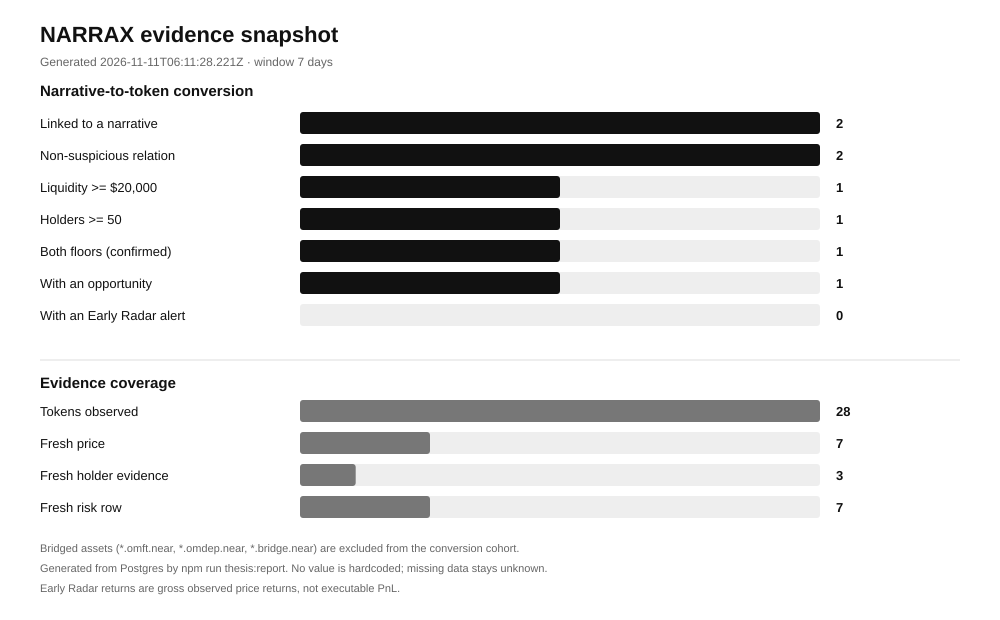

# NARRAX evidence snapshot

Generated: 2026-11-14T03:36:00.105Z
Window: 2026-11-07T03:36:00.105Z to 2026-11-14T03:36:00.105Z (7 days)

This is a generated snapshot of the local research database, not a backtest and not a price prediction. No value is hardcoded; missing data stays unknown.

## Research universe

| Metric | Value |
| --- | ---: |
| Active narratives | 12 |
| All narratives | 12 |
| Narrative mentions in window | 109 |
| Tokens observed | 49 |
| Tokens with a fresh price | 22 |
| Tokens with fresh holder evidence | 8 |
| Tokens with a fresh risk row | 26 |
| Narrative-token links | 40 |
| Opportunities in window | 16 |
| Early Radar alerts in window | 0 |

## Narrative-to-token conversion

Floors: liquidity >= $20,000 and holders >= 50.

Excluded 19 bridged-asset tokens (*.omft.near, *.omdep.near, *.bridge.near) from this cohort.

| Cohort | Tokens | Share of linked |
| --- | ---: | ---: |
| Linked to a narrative | 3 | 100.0% |
| …with a non-suspicious relation | 3 | 100.0% |
| …with liquidity >= $20,000 | 1 | 33.3% |
| …with >= 50 holders | 1 | 33.3% |
| …with both floors (confirmed) | 1 | 33.3% |
| …confirmed with fresh evidence | 1 | 33.3% |
| …with an opportunity | 1 | 33.3% |
| …with an Early Radar alert | 0 | 0.0% |

Fresh price rows: 2; fresh holder evidence: 1; both fresh: 1.
Median top-10 concentration among linked tokens with holder evidence: 19.1%.

## Early Radar outcomes

No Early Radar alerts in this window. This is a real zero-count, not a missing value.

## Smart money observations

| Metric | Value |
| --- | ---: |
| Wallets observed | 213 |
| Eligible profiles | 0 |
| Trades in window | 2,049 |
| Observed volume in window | $306,039.2 |
| Observation starts | 2026-11-07T21:23:48.000Z |
| Observation ends | 2026-11-14T02:41:44.000Z |

Smart-money history starts when collection starts. The provider feed is a recent window, not a complete archive.

## Collection quality (current snapshot)

Checked: 2026-11-14T03:36:00.105Z. Active narrative links or recent social handoff: 22/22.
Source-backed fresh prices: 0; missing: 19; stale: 1; future: 0; unverified: 2.
Holders: 1 fresh, 20 missing, 1 stale, 0 future. Fresh price + holders: 0.
Risk: 2 fresh, 19 missing, 1 stale, 0 future. Freshness is not a safety verdict.
Published calls in trailing 24h: 0; unknown frozen entry: 0; horizon states: {}.

Counters are repeated scan attempts, not unique tokens or missed calls. Daily totals cover recorded successful runs today (UTC), possibly a partial day. No telemetry means UNKNOWN. This snapshot is not historical attribution or proof of edge.

- market: STALE / UNKNOWN; last 2026-11-14T03:09:49.288Z; UTC-day runs 2; counters {"errors":12,"nearUsd":6.79,"infoCalls":14,"launchesSeen":76,"tokensCreated":0,"bridgedSkipped":38,"metricsWritten":37,"infoUnavailable":10,"riskRowsWritten":13,"tokensWithPrice":37,"tokensConsidered":43,"holderRowsWritten":3,"tokensWithoutData":6,"fdvUsedAsMarketCap":0,"holderFallbackRows":3,"priceCoverage.runs":2,"holderFallbackCalls":14,"price.social.failed":0,"priceOmissions.runs":2,"price.general.failed":0,"price.social.written":0,"price.general.written":19,"price.launches.failed":0,"price.outcomes.failed":0,"price.social.selected":0,"price.unpriced.failed":0,"price.general.selected":21,"price.launches.written":18,"price.outcomes.written":0,"price.unpriced.written":0,"price.launches.selected":22,"price.outcomes.selected":0,"price.unpriced.selected":38,"price.social.unavailable":0,"price.general.unavailable":0,"price.social.notRequested":0,"price.general.notRequested":2,"price.launches.unavailable":4,"price.outcomes.unavailable":0,"price.unpriced.unavailable":2,"price.launches.notRequested":0,"price.outcomes.notRequested":0,"price.unpriced.notRequested":36,"omission.launches.NO_MATCHING_PAIR":4,"omission.unpriced.NO_MATCHING_PAIR":2}
- social: STALE / UNKNOWN; last unknown; UTC-day runs unknown; counters unknown
- narrative: STALE / UNKNOWN; last unknown; UTC-day runs unknown; counters unknown

### Coverage by group (disjoint scanned sample)

| Group | Scanned | Fresh price | Stale price | Missing price | Unverified price | Future price | Fresh price + holders |
| --- | ---: | ---: | ---: | ---: | ---: | ---: | ---: |
| recentSocial | 0 | 0 | 0 | 0 | 0 | 0 | 0 |
| narrativeOnly | 22 | 0 | 1 | 19 | 2 | 0 | 0 |

Recent social is the unexpired collector handoff; narrative-only means an active narrative link outside that handoff, not proof of current qualification. Holder/risk freshness measures row age, not completeness or safety. Capped samples are not population estimates.

### Latest market price requests

Run: 2026-11-14T03:09:49.288Z (STALE). Excludes the separate NEAR reference-price request.

| Selection group | Selected | Written | No usable snapshot | Request failed | Not requested |
| --- | ---: | ---: | ---: | ---: | ---: |
| outcomes | 0 | 0 | 0 | 0 | 0 |
| social | 0 | 0 | 0 | 0 | 0 |
| launches | 3 | 2 | 1 | 0 | 0 |
| unpriced | 19 | 0 | 1 | 0 | 18 |
| general | 20 | 19 | 0 | 0 | 1 |

Instrumented UTC-day runs: 2 / 2 recorded runs. Partial instrumentation is not full-day coverage. No usable snapshot means a completed request returned none; it does not establish why the provider omitted it.

### Latest omission reasons

- launches.NO_MATCHING_PAIR: 1
- unpriced.NO_MATCHING_PAIR: 1

Reason-instrumented UTC-day runs: 2 / 2. One first blocking reason per omitted token attempt, not every missing field or proof a token does not trade. NO_MATCHING_PAIR means no validated NEAR base-token pair matched; UNSPECIFIED means the source supplied no reason. Failed/unrequested batches have no omission reason.

## Caveats

- Market evidence is mainnet NEAR only; there is no testnet market feed.
- Holder data may come from the NearBlocks fallback. Tokens NearBlocks has not indexed stay unknown.
- Counts are current database rows, not a complete market census.
- Early Radar returns are gross observed price returns, not executable PnL. The analytics report caveats apply in full.
- A missing value is reported as unknown, never as zero.
