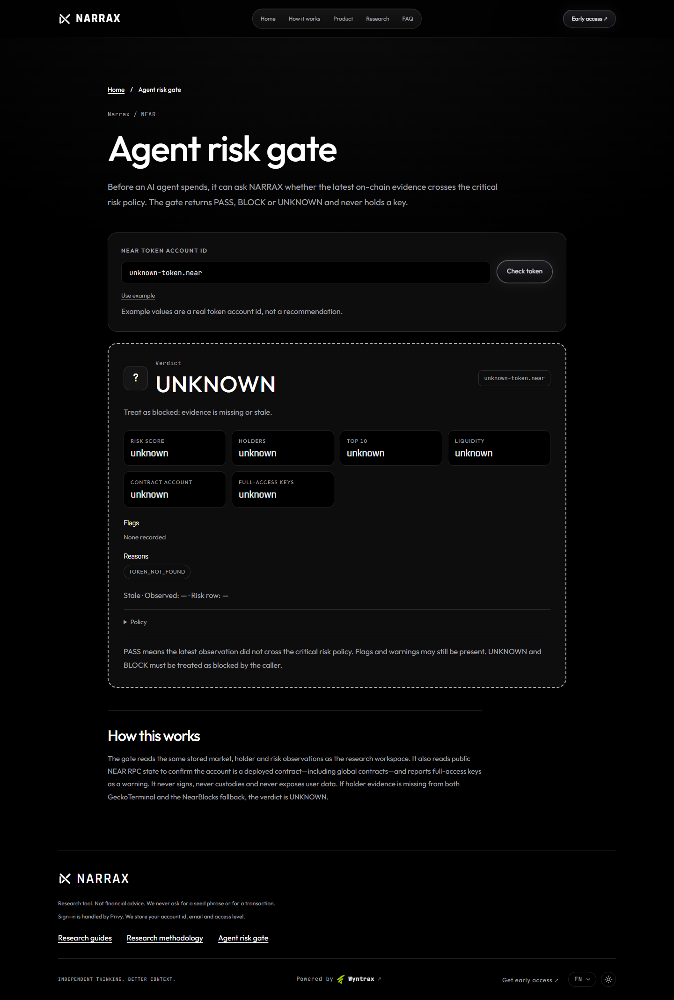

# Agent risk gate

A public, read-only safety check for AI agents that are about to spend. It answers one question:
**does the latest stored research evidence cross the critical risk policy for this token?**

It is not a wallet, a signer, a custodian, or a price prediction. NARRAX never holds an agent's keys.
The agent keeps its own wallet and policy; NARRAX supplies the scam and risk evidence.

## Endpoint

```
GET /v1/agent/risk/:mint
```

- `:mint` is a NEAR account id (named or 64-hex implicit).
- No authentication. Rate-limited to 60 requests per minute per client.
- Responses are `Cache-Control: no-store`.
- Only token-level safety facts are returned: no narratives, wallets, users, or private research.

### Example

```bash
curl -sS http://localhost:4000/v1/agent/risk/token.near
```

```json
{
  "mint": "token.near",
  "symbol": "TOKEN",
  "name": "Token",
  "blacklisted": false,
  "verdict": "BLOCK",
  "riskScore": 85,
  "flags": ["TOP10_OVER_60", "THIN_LIQUIDITY", "FEW_HOLDERS"],
  "metrics": {
    "priceUsd": 0.00042,
    "marketCapUsd": 420000,
    "liquidityUsd": 12000,
    "volume24hUsd": 8000,
    "at": "2026-11-10T11:59:00.000Z"
  },
  "holders": { "count": 31, "top10Pct": 72, "at": "2026-11-10T11:55:00.000Z" },
  "fresh": true,
  "observedAt": "2026-11-10T11:59:00.000Z",
  "riskAt": "2026-11-10T11:55:00.000Z",
  "reasons": ["RISK_SCORE_ABOVE_80"],
  "warnings": ["FULL_ACCESS_KEYS"],
  "contract": { "status": "CONTRACT", "fullAccessKeys": 1, "functionCallKeys": 2 },
  "policy": { "maxRiskScore": 80, "metricMaxAgeMs": 900000, "evidenceMaxAgeMs": 3600000 },
  "disclaimer": "PASS means the latest observation did not cross the critical risk policy; it is not a safety guarantee. Flags and warnings may still be present. UNKNOWN and BLOCK must be treated as blocked by the caller."
}
```

The values above are an example shape, not a live reading.

The public `/agent-risk` web page exposes the same check with a token input and verdict card.



For a local demo, the repository ships a small read-only client:

```bash
npm run agent:risk -- token.near
```

It exits `0` on `PASS`, `2` on `BLOCK` or `UNKNOWN`, and `1` when the request itself fails, so it can
be used as a shell policy gate.

## Verdicts

| Verdict | Meaning | Agent behavior |
| --- | --- | --- |
| `PASS` | Fresh market, holder and risk evidence exists, the token is not blacklisted, the account is a deployed contract, and the risk score is below 80. | The agent may continue to its own policy. Flags and warnings may still be present, so apply any stricter limits you need. This is not a safety guarantee. |
| `BLOCK` | The token is blacklisted, its risk score is at or above 80, its account is not a contract, or its account does not exist on chain. | Do not spend. |
| `UNKNOWN` | The token is unknown, required evidence is missing or stale, or the contract check failed. | Treat as blocked. Never infer low risk from missing data. |

`UNKNOWN` is intentional. If neither GeckoTerminal nor the NearBlocks fallback has holder evidence,
the token has no current price, the risk row is older than an hour, or the NEAR RPC contract check
fails, the gate fails closed rather than guessing.

## Contract safety facts

Before returning `PASS`, the gate asks the NEAR RPC whether the account actually has code deployed:

| Status | Meaning | Verdict effect |
| --- | --- | --- |
| `CONTRACT` | The account has deployed code, either its own `code_hash` or a `global_contract_hash`. | Can continue to the market/holder/risk checks. |
| `NOT_CONTRACT` | The account exists but has neither a code hash nor a global contract hash. | `BLOCK` (`NOT_A_CONTRACT`). An EOA cannot be a NEP-141 token. |
| `NOT_FOUND` | The account does not exist at finality. | `BLOCK` (`TOKEN_CONTRACT_NOT_FOUND`). A stored token row must not outlive its account. |
| `UNKNOWN` | The check could not be completed. | `UNKNOWN` (`CONTRACT_CHECK_UNAVAILABLE`). |

For a contract, the gate also reads the access-key list and returns `fullAccessKeys` and
`functionCallKeys`. The contract check always reads mainnet, because all market evidence is
mainnet-only; `AGENT_RISK_NEAR_RPC_URL` overrides the endpoint.

- `FULL_ACCESS_KEYS` is a **warning**, not a block. A token contract can legitimately keep an owner
  key for upgrades or metadata, but an agent policy may choose to treat it as stricter risk.
- `KEY_LIST_UNAVAILABLE` is a warning when the account is a contract but the key list cannot be read.
- Counts are never invented: an unreadable key list is `null`, not `0`.
- Results are cached for five minutes per account; failed checks retry after 30 seconds. Nothing is
  signed, transferred or deployed.
- Global contracts are recognized by `global_contract_hash`; the live NEARLY token uses one, so
  checking only `code_hash` would falsely reject it.

## Freshness and policy

| Evidence | Maximum age | Why |
| --- | --- | --- |
| Price, liquidity, volume | 15 minutes | Matches the research surface's staleness rule. |
| Holder count and concentration | 60 minutes | GeckoTerminal, then NearBlocks fallback. Refreshed less often than prices. |
| Deterministic risk row | 60 minutes | Derived from the latest market and holder evidence. |
| Contract code and access keys | 5 minutes | Read-only NEAR RPC query, cached briefly to absorb repeated agent calls. |

The block threshold is `riskScore >= 80`, matching the research pipeline's own critical-risk cutoff.
The score is deterministic and uses facts only: liquidity, holder count, top-10 concentration and
pair age. It is not a model prediction and it is not validated against returns.

## Agent policy example

The agent asks NARRAX before spending, then applies its own wallet policy. NARRAX never sees the
agent's key or the spend itself.

```ts
const api = process.env.NARRAX_API_URL ?? 'http://localhost:4000';

async function assertNarraxRiskGate(mint: string): Promise<void> {
  const response = await fetch(`${api}/v1/agent/risk/${encodeURIComponent(mint)}`);
  if (!response.ok) throw new Error(`risk gate unavailable: HTTP ${response.status}`);

  const risk = await response.json() as {
    verdict: 'PASS' | 'BLOCK' | 'UNKNOWN';
    fresh: boolean;
    reasons: string[];
    warnings: string[];
    contract: { status: string; fullAccessKeys: number | null } | null;
  };

  if (risk.verdict !== 'PASS' || !risk.fresh) {
    throw new Error(`blocked by NARRAX: ${risk.verdict} (${risk.reasons.join(', ')})`);
  }
  // Optional: enforce your own stricter policy on top of the gate.
  if (risk.contract?.fullAccessKeys !== 0) {
    throw new Error(`blocked by policy: full-access keys or unknown key list`);
  }
}
```

A useful demo: run the same check for a token below the policy threshold (`PASS`), a blacklisted or
high-risk token (`BLOCK`), and a token with no holder evidence (`UNKNOWN`). The agent's policy blocks
in two of the three cases without ever holding a key.

## Security model

- **No signing or custody.** The route only reads Postgres and public NEAR RPC state. There is no
  transaction path in the codebase.
- **No user data.** The response contains public token facts only. It does not expose narratives,
  wallets, grants or account identities.
- **Holder fallback is not a guarantee.** NearBlocks covers indexed NEAR tokens; an unindexed token
  stays `UNKNOWN` even if a DEX pool exists.
- **Fail closed.** Missing or stale evidence is `UNKNOWN`, and callers must treat it as blocked.
- **Rate limited.** 60 requests per minute per client.
- **Deterministic rules.** Risk flags come from named thresholds, not an LLM. The same inputs produce
  the same verdict.
- **Untrusted text stays out.** Token names and symbols are sanitized before storage; the risk gate
  does not return social text.

## Limits

- Mainnet market evidence only. DEX Screener and GeckoTerminal index mainnet NEAR.
- The risk score is a starting policy, not a guarantee. A `PASS` means the latest observation did not
  cross the critical threshold; known flags may still be present.
- Holder concentration can include pools and exchange accounts, so it may overstate concentration.
- Coverage is limited to tokens in the research universe. Everything else is `UNKNOWN`.
- The contract check proves code presence and key counts, not correctness. It is not a source-code
  audit, does not detect malicious logic, and does not verify the token implements NEP-141.
- Access-key permission is a point-in-time fact. The owner can add or remove keys after the check;
  the five-minute cache is a freshness bound, not a guarantee.
- The endpoint does not execute a trade, enforce a spending limit, or hold a key. The calling agent
  must enforce its own policy and limits.

## Why this is an AI Security & Defense entry

The track asks for scam detection and policy gates that let AI agents handle money without giving
them the keys to everything. This gate is exactly the scam-detection half: a deterministic,
fail-closed reputation check that an agent's spending policy can require before any transaction. It
also verifies that the target account is a deployed contract—not an EOA or a deleted account—and
surfaces full-access keys as a warning so the caller can apply a stricter policy. The agent keeps its
wallet and keys; NARRAX only supplies evidence and never gets signing authority.
